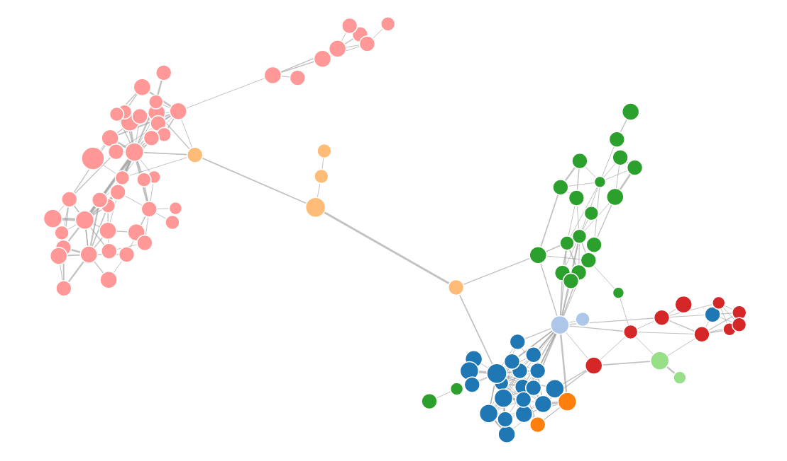

# DepView

Analyze calling dependencies in Java projects, and visualize them in a dependency graph.

You can use it to:

+ Get to know the structure of new projects, especially those with little documentation
+ Adjust package structure according to connections between classes

Related article: [Depview: Java 程序调用依赖关系的分析与显示](http://nettee.github.io/posts/2018/Depview-View-invocation-relationships-in-Java-projects/)



## Quickstart

This project targets **Java 8**.

Write a configuration file for the project that you want to analyze. Follow the examples in `conf-example/` directory.

Build and run DepView:

```Shell
export JAVA_HOME=/path/to/jdk8
export PATH="$JAVA_HOME/bin:$PATH"

mvn clean package
java -jar target/depview-0.2-SNAPSHOT.jar <CONF_FILE>
```

Now the dependencies is in directory `output/<PROJECT_NAME>/`. You can view the dependency graph by running:

```Shell
python3 -m http.server 8000 --bind 127.0.0.1 -d output/<PROJECT_NAME>
```

Open [localhost:8000](localhost:8000) to view the dependency graph.

Example on macOS when Java 8 is installed but not the default Java:

```Shell
export JAVA_HOME="/Library/Java/JavaVirtualMachines/jdk1.8.0_221.jdk/Contents/Home"
export PATH="$JAVA_HOME/bin:$PATH"

mvn clean package
java -jar target/depview-0.2-SNAPSHOT.jar conf-example/depview-mac.conf
python3 -m http.server 8000 --bind 127.0.0.1 -d output/DepView
```
