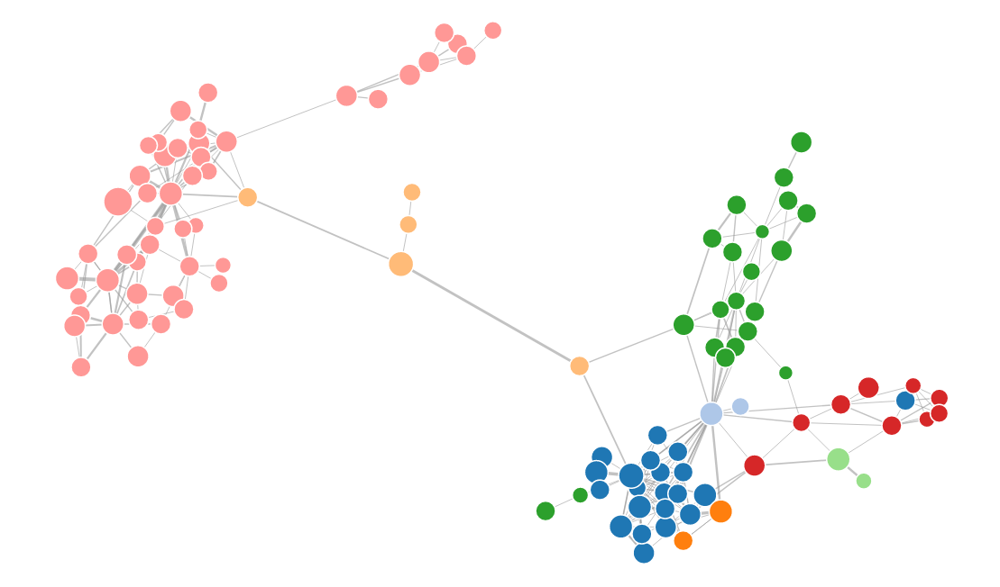

# DepView

分析 Java 项目中的调用依赖关系，并将其可视化为依赖图。

[English](./README.md) | [简体中文](./README_zh.md)

如果你想了解这个工具的更多背景，可以阅读[这篇文章](https://nettee.io/blog/depview-java-code-dependencies-view/)。



在线体验效果： [nettee.io/depview](https://nettee.io/depview/)

## ✨ 功能

- 可视化 Java 项目中的调用依赖关系
- 帮助快速了解新项目的结构，尤其是文档较少的项目
- 帮助根据类之间的连接关系调整包结构

## 🚀 快速开始

本项目基于 **Java 8**。

为你想分析的项目编写配置文件，可参考 `conf-example/` 目录中的示例。

构建并运行 DepView：

```bash
export JAVA_HOME=/path/to/jdk8
export PATH="$JAVA_HOME/bin:$PATH"

mvn clean package
java -jar target/depview-0.2-SNAPSHOT.jar <CONF_FILE>
```

生成的依赖结果位于 `output/<PROJECT_NAME>/`。运行下面的命令查看依赖图：

```bash
python3 -m http.server 8000 --bind 127.0.0.1 -d output/<PROJECT_NAME>
```

然后在浏览器中打开 [http://localhost:8000](http://localhost:8000)。

### macOS 示例

如果在 macOS 上安装了 Java 8，但系统默认 Java 不是 Java 8：

```bash
export JAVA_HOME="/Library/Java/JavaVirtualMachines/jdk1.8.0_221.jdk/Contents/Home"
export PATH="$JAVA_HOME/bin:$PATH"

mvn clean package
java -jar target/depview-0.2-SNAPSHOT.jar conf-example/depview-mac.conf
python3 -m http.server 8000 --bind 127.0.0.1 -d output/DepView
```
